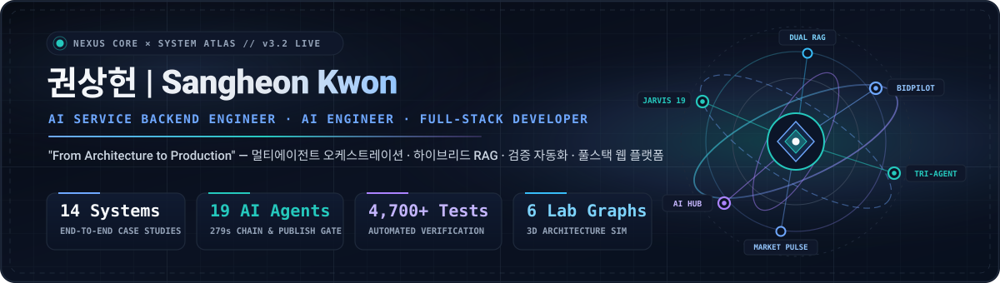

 
 

현재 **주식회사 링크21(Link21 Inc.)** 에 재직 중이며,  
19명 AI 에이전트 오케스트레이션 · 공공입찰 하이브리드 RAG · 3-CLI 코딩 파이프라인 · 상용 웹 플랫폼을  
**설계 → 구현 → 검증 게이트 → 배포 → 운영**까지 End-to-End로 구축합니다.

 

---

## ⚡ Core Engineering Highlights

| 🤖 Multi-Agent & Guardrails | 📊 Verified Test Suites | 🚀 Live Production Web & AI | 🧠 Domain RAG & ML Pipelines |
| :---: | :---: | :---: | :---: |
| **19 AI Agents Chain** (JARVIS, 279s) 점수와 분리된 **Publish Gate** (18/19 통과) **3-CLI 고정 역할 파이프라인** (TriAgent) | **총 4,700+ 자동화 테스트** BidPilot `2,659` · JARVIS `1,144` AI Hub `515` · TriAgent `384` | **link21premium.com** (공식 교육 플랫폼) **aihub.link21premium.com** (명함·AI 허브) **링키 (Linky)** (의도 라우팅·SSE 챗봇) | **중대재해 법령 이중 RAG** (78.8→90.0점) **다나와 5.8만 건 시세·적정가 ML** (`R² 0.78`) **공공입찰 자격·요구사항 추출** (`188/191`) |

---

## 🛠 기술 스택 (Tech Stack)

### Backend / Infra & Database

-003B57?style=for-the-badge&logo=sqlite&logoColor=white)

### AI / ML & Multi-Agent

### Frontend & 3D Web

### Testing, DevOps & Certifications

-0078D4?style=for-the-badge&logo=microsoftazure&logoColor=white)

---

## 📂 주요 프로젝트 (14 Projects)

| 프로젝트 | 설명 | 기술 |
|----------|------|------|
| **[link21-ai-jarvis-office](https://kwsahe.github.io/kwsahe/work/link21-ai-jarvis-office/)** *(Private)* | AI 직원 19명(전략실 8 · 제작실 11) 단일·동시·체인 실행(279초) · 점수와 분리한 게시 가능 판정(Publish Gate, 18/19 통과) · 말로 부탁하기 대화 입력 · 웹자보·카드뉴스 PNG (단위 873·통합 252·렌더 19 테스트) | React 19 · TypeScript · vinext · Cloudflare Workers · D1(Drizzle ORM) · OpenAI Responses API · Zod |
| **[link21-bidpilot-ai](https://kwsahe.github.io/kwsahe/work/link21-bidpilot-ai/)** *(Private)* | 나라장터·기업마당 공고 자동 수집 · 규칙 엔진 자격 판정(188/191) · 쪽 보존 요구사항 추출(Precision 0.795, Recall 0.843) · 제안서 초안 및 제출 전 누락 감사 (자동 시험 2,659개 · 검수 36회) | Python · FastAPI · Next.js 16 · React 19 · Three.js · Claude Code · Codex · G2B OpenAPI |
| **[link21-ai-hub](https://aihub.link21premium.com/)** *(Live / Private)* | 디지털 명함(vCard·QR) · 금속 원근 레이저 각인 미리보기 · OpenCV 제품 사진 개인정보 제거 · AI 치트키 200 리드 수집 및 주문 관리 통합 허브 ([실배포](https://aihub.link21premium.com/) · [케이스 스터디](https://kwsahe.github.io/kwsahe/work/link21-ai-hub/)) | Next.js 16 · React 19 · TypeScript · Supabase · Zod · OpenCV · Vitest(515) · Vercel |
| **[link21-premium](https://www.link21premium.com/)** *(Live / Private)* | 실제 기업 고객이 사용하는 LINK21 공식 기업 AI 교육 플랫폼 구축·운영 · 일정 캘린더 · 수강신청 및 관리자 XLSX 대시보드 ([실배포](https://www.link21premium.com/) · [케이스 스터디](https://kwsahe.github.io/kwsahe/work/link21-premium/)) | Next.js 16 · React 19 · TypeScript · Supabase · Tailwind CSS · Vercel |
| **[link21-ai-chatbot (링키)](https://kwsahe.github.io/kwsahe/work/link21-ai-chatbot/)** *(Live / Private)* | LINK21 웹서비스 공식 AI 챗봇 0→1 설계·구현·운영 · 질문 의도 분류 라우팅 및 SSE 실시간 토큰 스트리밍 ([실배포](https://www.link21premium.com/)) | Next.js · TypeScript · Gemini API · OpenAI API · SSE · Supabase |
| **[tri-agent-control](https://github.com/kwsahe/tri-agent-control)** | Claude Code(구현) · Antigravity(테스트) · Codex(검토) 고정 역할 코딩 파이프라인 · 세션별 git worktree · 실사용 결함 5건 검출 · 평가 하니스(14과제) 및 회귀 테스트 384개 ([케이스 스터디](https://kwsahe.github.io/kwsahe/work/tri-agent-control/)) | Python · Multi-Agent · Claude Code · Codex · Antigravity · git worktree |
| **[market-pulse](https://github.com/kwsahe/market-pulse)** | 다나와 9개 카테고리 약 5.8만 건(57,690건) 매일 자동 수집 · React 19 + Three.js 3D 데스크 · FastAPI 17개 API · 로그 가격 ML 적정가 예측(R² 0.78) ([실배포 데모](https://kwsahe.github.io/market-pulse/) · [케이스 스터디](https://kwsahe.github.io/kwsahe/work/market-pulse/)) | React 19 · TypeScript · Three.js · FastAPI · SQLite(WAL) · Scikit-learn · Pytest(196) |
| **[k-safety-law-rag](https://github.com/kwsahe/k-safety-law-rag)** | 건설현장 법령·매뉴얼 이중 ChromaDB RAG · Claude Opus 4.6 연동 및 모델별 답변 경로 분리 (종합 테스트 78.8점 → 90.0점, 회귀 테스트 41개) ([케이스 스터디](https://kwsahe.github.io/kwsahe/work/k-safety-law-rag/)) | Python · Claude Opus 4.6 · ChromaDB · bge-m3 · EXAONE-4.0 · Qwen2.5-14B · FastAPI |
| **[business-card-auto](https://business-card-auto.vercel.app)** *(Private)* | 행사 현장용 프라이버시 우선 무서버 vCard 3.0 QR 디지털 명함 생성 웹앱 ([실배포](https://business-card-auto.vercel.app) · [케이스 스터디](https://kwsahe.github.io/kwsahe/work/business-card-auto/)) | Next.js 15 · TypeScript · HTML5 Canvas · Tailwind CSS · Vercel |
| **[construction-accident-vl-agent](https://github.com/kwsahe/construction-accident-vl-agent)** | CCTV 영상 → OpenCV 프레임 Contact Sheet 합성 → 사고 시점·유형·원인 판단 Vision-Language Agent & YOLO 어댑터 ([케이스 스터디](https://kwsahe.github.io/kwsahe/work/construction-accident-vl-agent/)) | Python · Qwen2.5-VL · OpenCV · YOLO · FastAPI · Pydantic |
| **[O2O-demand-forecasting-solution](https://github.com/kwsahe/O2O-demand-forecasting-solution)** | 공공 API 5종 결합 102개 시군구 인테리어 수요점수 산출 · SARIMA/Prophet/LightGBM 3종 시계열 거래량 예측 비교 ([케이스 스터디](https://kwsahe.github.io/kwsahe/work/O2O-demand-forecasting-solution/)) | Python · Flask · SARIMA · Prophet · LightGBM · Ollama |
| **[ecommerce-data-analysis-practice](https://github.com/kwsahe/ecommerce-data-analysis-practice)** | 23일 데이터 부트캠프 — RFM 고객 세분화 · SHAP 모델 해석(XAI) · Prophet 시계열 예측 대시보드 ([케이스 스터디](https://kwsahe.github.io/kwsahe/work/ecommerce-data-analysis-practice/)) | Python · Scikit-learn · XGBoost · SHAP · Streamlit |
| **[english-word-streamlit](https://github.com/kwsahe/english-word-streamlit)** | Google Gemini API 연동 AI 단어 학습 및 토익 빈칸 시험 생성 ([실배포](https://honeyenglish.streamlit.app) · [케이스 스터디](https://kwsahe.github.io/kwsahe/work/english-word-streamlit/)) | Python · Streamlit · Google Gemini · Kivy |
| **[Artesia](https://github.com/kwsahe/Artesia)** | Unity2D 로그라이크 턴제 던전 RPG · 팀장·기획 총괄 ([케이스 스터디](https://kwsahe.github.io/kwsahe/work/Artesia/)) | C# · Unity2D |
